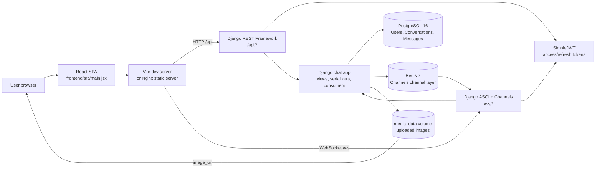

# Chatty Architecture Documentation

## 1. System overview

Chatty is a full-stack, real-time, one-to-one messaging application. The browser loads a React single-page application from Vite during development or Nginx in the containerized deployment. The frontend communicates with Django through two transports:

- **HTTP/JSON REST** for authentication, user search, conversation management, message history, image uploads, pinning, and deletion.
- **WebSockets** for authenticated text-message delivery and real-time message events.

Django stores users, conversations, and messages in PostgreSQL. Redis is used by Django Channels as the channel layer so WebSocket events can be routed through the backend. Uploaded images are stored in the backend media volume and exposed through Django's media route.

## 2. Architecture diagram



### Deployment routing

In Docker, the frontend container runs Nginx:

1. `/` serves the compiled React files and falls back to `index.html` for the SPA.
2. `/api/` is proxied to the Django backend on port `8000`.
3. `/ws/` is proxied as an HTTP/1.1 WebSocket upgrade to Django ASGI.
4. `/media/` is proxied to Django so uploaded images can be displayed.

During local development, Vite proxies `/api` and `/ws` to `http://localhost:8000`, avoiding browser CORS issues for those paths.

## 3. Repository structure

```text
Projet_RINGN/
├── backend/
│   ├── manage.py                 Django management entry point
│   ├── requirements.txt          Python dependencies
│   ├── Dockerfile                Backend image
│   ├── entrypoint.sh             Container startup helper
│   ├── config/
│   │   ├── settings.py           Django, database, REST, CORS, Channels config
│   │   ├── urls.py               Root HTTP routes
│   │   ├── asgi.py               HTTP/WebSocket ASGI composition
│   │   └── __init__.py
│   └── chat/
│       ├── models.py             Conversation and Message persistence models
│       ├── serializers.py        REST/WebSocket response and input shaping
│       ├── views.py              REST API behavior and authorization
│       ├── urls.py                Chat API routes
│       ├── consumers.py          WebSocket chat consumer
│       ├── middleware.py         JWT extraction for WebSocket connections
│       ├── routing.py             WebSocket URL pattern
│       └── migrations/            Database schema history
├── frontend/
│   ├── package.json              Node scripts and frontend dependencies
│   ├── src/main.jsx              React application and UI behavior
│   ├── src/styles.css            Application styling and responsive layout
│   ├── vite.config.js            Dev server and proxy configuration
│   ├── nginx.conf                Production reverse-proxy/static configuration
│   └── Dockerfile                Build-then-serve frontend image
├── docker-compose.yml             PostgreSQL, Redis, backend, frontend services
├── .env.example                   Environment variable template
└── README.md                      Local and Docker usage instructions
```

The frontend currently uses a single React module rather than a component directory or client-side router. The backend uses one Django application (`chat`) with framework-provided authentication and administration modules.

## 4. Frontend architecture

### Runtime and tools

- **React** and **React DOM** provide the UI and browser rendering.
- **Vite** provides the development server and production build.
- **Axios** provides the REST client.
- **Bootstrap** supplies baseline CSS utilities/components; application-specific styling is in `src/styles.css`.
- **Native WebSocket** provides real-time messaging.
- **Nginx** serves the production build and proxies backend traffic.

### Application state

`frontend/src/main.jsx` owns the application state with React hooks:

- Authentication: access token, username, registration mode, auth errors/loading.
- Conversation navigation: conversation list and selected conversation.
- Messages: loaded history, incoming WebSocket events, composer body, selected image.
- User discovery: debounced username search and search results.
- Connection: one WebSocket reference for the selected conversation.

The access token and username are persisted in `localStorage`. When a token is present, Axios receives an `Authorization: Bearer <token>` header and the conversation list is loaded.

### Frontend flows

1. **Authentication:** registration posts credentials to `/api/auth/register/`; sign-in posts to `/api/auth/token/` and stores the access token.
2. **Conversation discovery:** username input is debounced for 250 ms and queries `/api/users/?search=...`.
3. **Conversation selection:** conversation history is loaded over REST, then the previous socket is closed and a new WebSocket is opened for the selected conversation.
4. **Text message:** text is sent over the WebSocket when it is open.
5. **Image message:** text/image content is sent as multipart form data over REST.
6. **Live updates:** WebSocket packets update, append, or remove messages according to their event name.
7. **Sign-out:** local storage is cleared and the authenticated view is replaced with the login screen.

## 5. Backend architecture

### HTTP entry point

`backend/config/urls.py` exposes:

- Django admin at `/admin/`.
- JWT token obtain and refresh routes.
- The `chat` API under `/api/`.
- Uploaded media under `/media/<path>`.

`backend/config/settings.py` sets Django REST Framework's default authentication to SimpleJWT and its default permission to `IsAuthenticated`. Registration explicitly overrides that permission with `AllowAny`.

### REST API layer

The `chat` app uses Django REST Framework generic views:

| Responsibility | Implementation |
|---|---|
| Registration | `RegisterView` + `RegistrationSerializer` |
| Username search | `UserListView` + `UserSerializer` |
| Conversation list/create | `ConversationListCreateView` + `ConversationSerializer` |
| Message list/create | `MessageListView` + `MessageSerializer` |
| Message update/delete | `MessageDetailView` |

The message list/create endpoint accepts JSON, regular form data, and multipart form data. Message images are validated to a maximum size of 10 MB.

Authorization is participant-based: conversation and message queries require the authenticated user to be a participant. A user can delete only messages they sent. Message updates are used by the frontend to toggle pin state.

### WebSocket layer

`backend/config/asgi.py` composes:

- Django's ASGI application for HTTP.
- `JwtAuthMiddleware` and Channels `URLRouter` for WebSockets.

The middleware reads the JWT from the WebSocket query string (`?token=...`), resolves the user, and stores it in the ASGI scope. `ChatConsumer` then:

1. Reads the conversation ID from the URL.
2. Rejects non-participants with close code `4403`.
3. Joins the Redis-backed group `conversation_<id>`.
4. Validates text message presence and the 4,000-character limit.
5. Persists the message asynchronously through `database_sync_to_async`.
6. Broadcasts `message.created` to all connected participants.

REST-created, updated, and deleted messages also broadcast through the same channel group, keeping HTTP and WebSocket clients synchronized.

## 6. Data and persistence model

The project uses PostgreSQL through Django's PostgreSQL backend and `psycopg[binary]`.

### User

Django's built-in `auth.User` model stores credentials and usernames. It is referenced by conversations and messages.

### Conversation

- `id`: auto-generated primary key.
- `participants`: many-to-many relationship to `User`.
- `created_at`: creation timestamp.

The current application treats conversations as private conversations between two users. The model itself does not enforce a two-participant database constraint.

### Message

- `id`: auto-generated primary key.
- `conversation`: foreign key; deleting a conversation cascades to messages.
- `sender`: foreign key to `User`; deleting a user cascades to their messages.
- `body`: optional text up to 4,000 characters.
- `image`: optional file under `chat-images/YYYY/MM/`.
- `is_pinned`: boolean flag.
- `created_at`: creation timestamp.

Messages are ordered by `created_at`. Image URLs are generated as absolute URLs by the serializer when a request context is available.

## 7. Frameworks, libraries, and tooling

### Backend

| Technology | Version in manifest | Role |
|---|---:|---|
| Python | 3.12 container image | Runtime |
| Django | 5.1.7 | Web framework, ORM, admin |
| Django REST Framework | 3.15.2 | REST API |
| SimpleJWT | 5.5.0 | JWT authentication |
| Django Channels | 4.2.0 | WebSocket support |
| Daphne | 4.1.2 | ASGI server |
| channels-redis | 4.2.1 | Redis channel layer integration |
| redis | 5.2.1 | Python Redis client |
| django-cors-headers | 4.7.0 | CORS configuration |
| psycopg | 3.2.5 | PostgreSQL driver |
| Pillow | 11.1.0 | Image field processing |

### Frontend and delivery

| Technology | Role |
|---|---|
| Node.js 22 Alpine | Frontend build runtime |
| React / React DOM | UI |
| Vite | Development server and bundler |
| Axios | HTTP client |
| Bootstrap | CSS dependency |
| Nginx 1.27 Alpine | Static file server and reverse proxy |

### Infrastructure

| Technology | Role |
|---|---|
| Docker Compose | Local multi-service orchestration |
| PostgreSQL 16 Alpine | Persistent relational database |
| Redis 7 Alpine | Real-time channel layer |
| Docker named volumes | PostgreSQL data and uploaded media persistence |

## 8. Configuration and operational behavior

Configuration is environment-driven. Important variables are documented in `.env.example`:

- `DJANGO_SECRET_KEY`, `DJANGO_DEBUG`, `DJANGO_ALLOWED_HOSTS`
- `CORS_ALLOWED_ORIGINS`
- `POSTGRES_DB`, `POSTGRES_USER`, `POSTGRES_PASSWORD`, `POSTGRES_HOST`, `POSTGRES_PORT`
- `VITE_API_URL`
- `REDIS_URL` (with a backend default of `redis://redis:6379/0`)

The backend container runs migrations before starting Daphne. The frontend container builds static assets first, then runs Nginx. PostgreSQL has a Compose health check; the backend waits for PostgreSQL health and Redis startup before starting.

## 9. Important boundaries and limitations

- There is one frontend entry module and no separate frontend routing layer.
- There is one Django domain app (`chat`); Django's built-in auth/admin modules provide shared platform functionality.
- JWT access tokens are passed in the WebSocket query string because the browser WebSocket API does not provide a standard custom-header option.
- WebSocket text sending does not include image uploads; images use the REST multipart endpoint.
- The repository does not contain a separate background worker, notification service, search service, or test suite.
- The default development secret and database password are placeholders and must be replaced for any real deployment.

